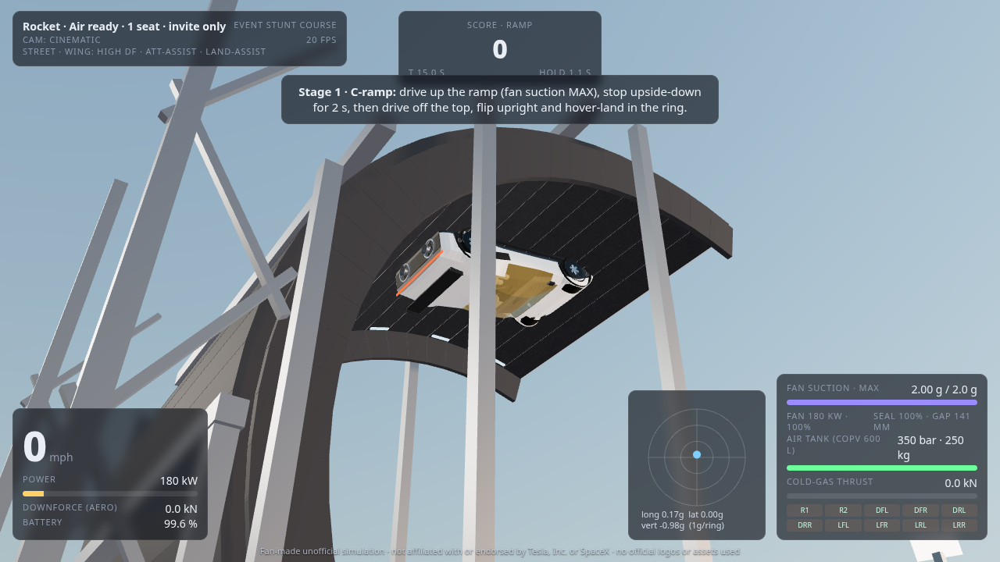
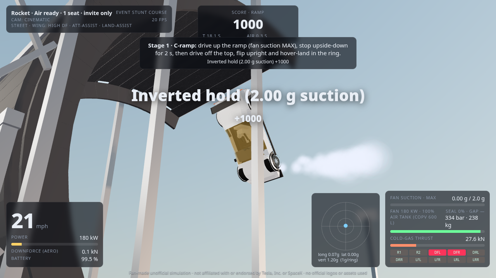
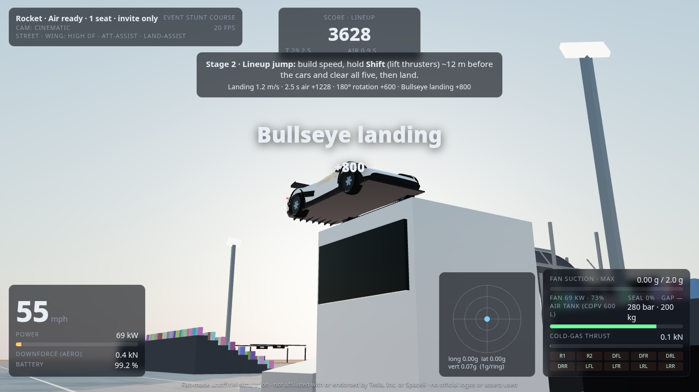
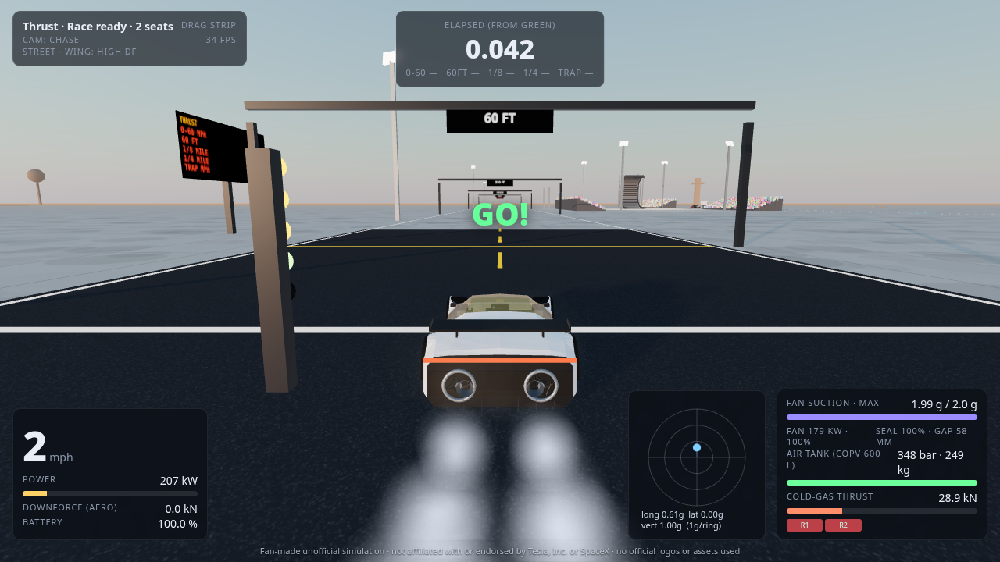
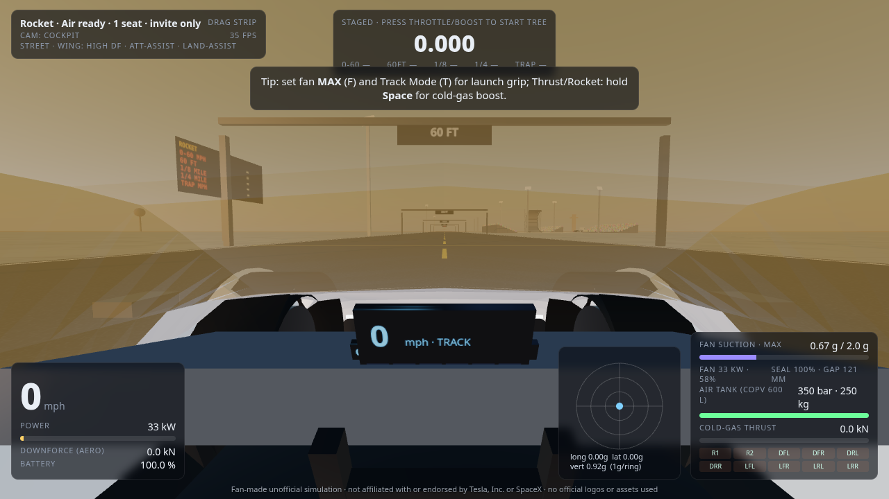
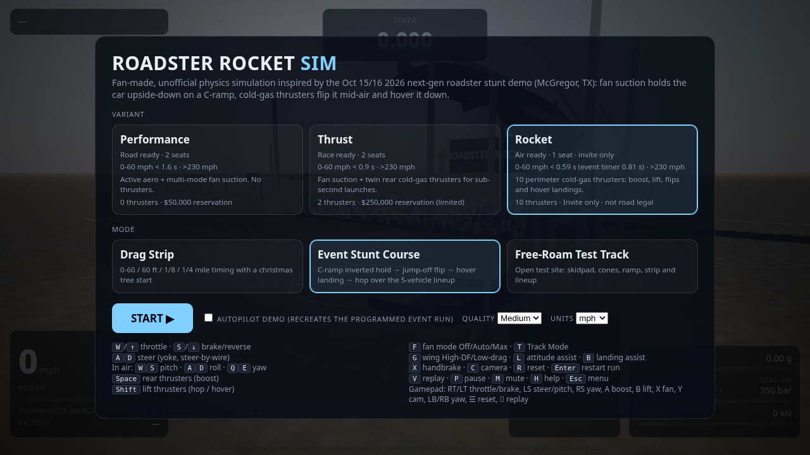

# Roadster Rocket Sim

**A fan-made, unofficial 3D browser simulation.** It is inspired by the next-gen electric roadster stunt demo shown on 15/16 Oct 2026 at a rocket-engine test site in McGregor, Texas. In that demo, fan suction held the car upside-down on a C-shaped ramp. Cold-gas thrusters then flipped it in mid-air, hovered it down to a landing and hopped it over a row of five parked vehicles.

> Not affiliated with or endorsed by Tesla, Inc. or SpaceX. No logos, trademarks or official assets are used. Every 3D model is procedural geometry written in this repo.

**Play:** https://jakobcvetko.github.io/roadster-rocket-sim/ (static build on GitHub Pages; the same build is used for the k8s manifests)

| | |
|---|---|
|  |  |
|  |  |
|  |  |

## Modes
* **Event Stunt Course**
  * Stage 1, C-ramp: drive up a clothoid-entry C-ramp (R = 7 m, 200°, about 14.5 m tall) with the fans on MAX and stop upside-down for 2 s. Then drive off the top. Attitude control rolls the car upright and landing assist hovers it down into the ring.
  * Stage 2, lineup jump: hop over five parked vehicles using the lift thrusters. The vehicles are generic originals: a robotaxi, an angular pickup, a semi tractor, a crossover and a sedan.
  * Scoring: inverted hold, rotation, landing softness, bullseye and a clean clear give S–D grades.
* **Drag Strip**: christmas-tree start with red-light detection. Timers for 0-60 mph, 0-100 km/h, 0-100 mph, 60 ft, 1/8 mile, 1/4 mile and trap speed, plus 1 km and 1 mile markers on a 1.9 km strip, with an in-world timing board.
* **Free-Roam Test Track**: skidpad, dynamic cone slalom, the ramp, the strip and the lineup. Blue pads refill the air tank.
* **Autopilot demo** (menu checkbox or `?autopilot`): a scripted run that recreates the programmed event stunts. A humanoid robot "drives" from the driver's seat, as at the event.

## Physics (cannon-es rigid body + custom vehicle model, fixed 120 Hz)
* **Suspension**: four raycast wheels with linear springs, a damper, anti-roll bars and bump stops. Track Mode lowers the car by 50 mm. Weight transfer comes out of the rigid-body dynamics.
* **Tyres**: simplified Pacejka lateral curve with a friction circle and load-sensitive grip (μ·Fz), plus rolling resistance and a handbrake. Steer-by-wire uses a speed-dependent ratio and Ackermann geometry.
* **Powertrain**: tri-motor AWD split 40/60. Force is capped and power is limited (shared with the fans, 1.5 MW pack peak), with an electronic limit of about 234 mph.
* **Aero**: drag plus downforce ∝ v². The active wing has two modes: High-DF (ClA 1.25) and Low-drag.
* **Fan suction ("multi-mode fan + ground sealing")**: fans spool up, draw power (P ∝ fan³) and seal against the surface through flexible skirts depending on floor gap. Suction is applied along the surface normal and **capped at 2.0 g**. That is enough to hold the car inverted when stationary (net 1 g into the ceiling). Modes are OFF, AUTO and MAX. Suction dumps automatically when the lift thrusters fire.
* **Cold-gas thrusters**: each nozzle is modelled individually (position, direction, max thrust, 40 ms electric valve actuators).
  * Air comes from a **600 L COPV bank at 350 bar** (about 250 kg of air), using the ideal-gas pressure model.
  * Mass flow is F/(Isp·g0) with Isp 72 s. Car mass drops as air is used.
  * Thrust fades below 60 bar and stops at 20 bar.
  * Refill comes from an onboard compressor (slow) or a pad (fast).
* **Attitude control (Rocket)**: rate-command PD controller with thruster allocation. The four ventral nozzles handle pitch and roll, the four lateral nozzles handle yaw, and the rear nozzles provide boost and yaw. Auto-level assist and altitude-scheduled landing assist can each be toggled.

### Variant model (public figures + engineering estimates)
| | Performance | Thrust | Rocket |
|---|---|---|---|
| Seats | 2 | 2 | 1 |
| Thrusters | none | 2 rear × 21 kN | 10 perimeter: 2 rear × 18.5 kN, 4 ventral × 14 kN, 4 lateral × 4.5 kN (≈ 111 kN total) |
| Public 0-60 claim | < 1.6 s | < 0.9 s | < 0.59 s (event timer showed 0.81 s) |
| **Sim 0-60 (autopilot)** | **1.46 s** | **0.75 s** | **0.82 s** |
| Top speed | > 230 mph (all) | | |

Dimensions in the sim are about 4.25 m × 2.0 m × 1.12 m with a 2.75 m wheelbase. Mass is about 1.8–1.9 t dry plus air (reported as "4000+ lb"). Tesla has not published dimensions, power or thrust per nozzle, so those values are estimates tuned to reproduce the public numbers.

## Car model (original, procedural)
* Body: an angular wedge loft with flat-shaded creases, a reference to the "SR-71 / F-35 / Esprit-like" design language described in coverage. Paint is a satin pearl white ("Ano White"-like).
* Lights: a hidden-headlight light slit and a full-width rear light bar.
* Glass: a gold-tinted canopy (the spacesuit-visor reference), which gives the cockpit view its gold tint.
* Rear: two rear fans with spinning blades, a diffuser, ground-seal skirts and an active rear wing.
* Thrusters: bell nozzles that change per variant.
* Wheels: dark aero wheels with brake discs and calipers.
* Interior: an Ultrawhite-like seat (one seat or two, depending on variant), a gray microsuede dash, a yoke, a centre touchscreen and two small forward displays.
* Driver: a generic humanoid robot.

## Controls
| Action | Keyboard | Gamepad | Touch |
|---|---|---|---|
| Throttle / brake-reverse | W / S (↑ ↓) | RT / LT | GO / BRK |
| Steer (ground), roll (air) | A / D (← →) | Left stick X | stick |
| Pitch (air) | W / S | Left stick Y | stick |
| Yaw (air) | Q / E | Right stick X, LB/RB | – |
| Rear thrusters (boost) | Space | A | BOOST |
| Lift thrusters (hop / hover) | Shift | B | LIFT |
| Fan mode Off/Auto/Max | F | X | FAN |
| Camera Chase / Cockpit / Cinematic | C | Y | CAM |
| Track Mode / wing mode | T / G | D-pad ↑ / ↓ | – |
| Attitude assist / landing assist | L / B | D-pad ← / → | – |
| Replay (scrub ←/→, speed ↑) | V | Back | REPLAY |
| Reset / restart / next stage | R / Enter / N | Start | RESET |
| Pause / mute / help / menu | P / M / H / Esc | – | MENU |

Other features:
* Procedural WebAudio for motor and inverter whine, fan roar, thruster hiss, tyre squeal, wind and impacts.
* A 60 s replay buffer.
* Cameras: spring chase cam (with collision against the ramp), cockpit cam, and a cinematic auto-cut trackside/drone cam.
* GPU particles for cold-gas plumes, tyre smoke and landing dust.
* Dusk sky with PMREM reflections and PCF soft shadows.

URL flags: `?mode=stunt|drag|free&variant=performance|thrust|rocket&autostart&autopilot&q=low|medium|high&cam=0|1|2`

## Build / run
```bash
npm ci
npx vite            # dev server
npx vite build      # static build in dist/
docker build -t roadster-rocket-sim . && docker run -p 8080:8080 roadster-rocket-sim
```
Headless checks (puppeteer-core + Chrome/SwiftShader): `node sim.mjs "mode=stunt&variant=rocket&autostart&autopilot&q=low" 40 0.5` steps the physics headless. `node shots.mjs` renders the screenshots in `docs/`.

## Kubernetes
`k8s/` contains a namespace, Deployment, Service and Ingress.
* **No registry needed**: an initContainer shallow-clones the `gh-pages` branch (the prebuilt site) into an emptyDir, and stock `nginx:alpine` serves it.
* `k8s/deployment-image.yaml` is the alternative if you push the Dockerfile image to a registry.
* Edit the host and ClusterIssuer in `k8s/ingress.yaml` to match the cluster, then run `kubectl apply -f k8s/`.

## Known limitations
* Tyres are a steady-state slip model. Wheel spin is not integrated as its own degree of freedom.
* The chassis does not collide with the ramp (wheels contact it through raycasts), which avoids snagging on segment edges.
* The 2 g suction cap, the 80 kN-class thrust and the remaining physical values are estimates. Tesla has not published full specs.
* The quarter-mile time with thrusters is extremely short, because there is no aero or legal limit on thrust above the motor speed limit.

## Sources (accessed 16 Oct 2026)
* Tesla Roadster page (variants, suction/fan system, cold-gas thrusters, materials): https://www.tesla.com/roadster
* TechCrunch, "Tesla reveals SpaceX-powered Roadster that flies and falls with style" (10 thrusters, 600 L compressed air, COPVs, lineup vehicles, SR-71/F-35 inspiration): https://techcrunch.com/2026/10/15/tesla-reveals-spacex-powered-roadster-that-flies-and-falls-with-style/
* Engadget live blog and "Relive Tesla's Roadster stunt show" (C-ramp, inverted hold, robot in driver seat, thrusters and fans at the rear): https://www.engadget.com/2287518/tesla-roadster-launch-live-blog/ · https://www.engadget.com/2288448/relive-tesla-ridiculously-fun-roadster-stunt-show/
* CNBC, "Tesla Roadster reveal: what to know" (McGregor test site, steer-by-wire, yoke): https://www.cnbc.com/2026/10/15/tesla-roadster-reveal-what-to-know-about-the-delayed-ev.html
* Road & Track (0-60 in 0.81 s timer, ten nozzles, > 230 mph): https://www.roadandtrack.com/news/a74151425/the-air-assisted-tesla-roadster-flies-in-demo-hits-0-60-in-08-seconds/
* The Verge event report: https://www.theverge.com/transportation/1012552/tesla-roadster-next-gen-reveal-elon-musk
* Teslarati specs/configurations (hidden headlights, full-length taillight, Ano White, Ultrawhite interior, gold-tinted glass): https://www.teslarati.com/tesla-roadster-specs-configurations/

Car and Driver coverage was searched for but not used. Reference photos were viewed only for proportions; no images are redistributed.

MIT licensed code. Not an official product.
